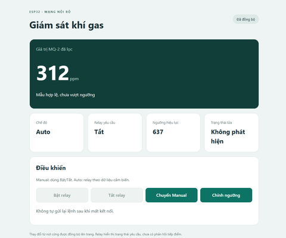
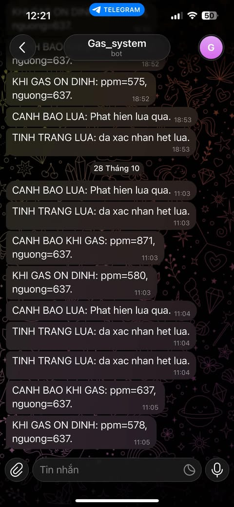
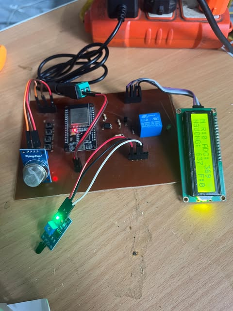

# ESP32 Gas Monitoring System

## 1. Project overview and features

This is an ESP-IDF firmware project for the ESP32-DevKit V1. The system reads the MQ-2 gas sensor and a digital flame sensor, controls a relay, displays the status on an I2C LCD1602, provides a web interface on the local Wi-Fi network, and can send alerts through a Telegram Bot.

### Main features

- Reads the MQ-2 analog AO output through the ESP32 ADC1.
- Filters up to four ADC samples and rejects invalid, stale, or timed-out samples.
- The current MQ-2 value is a raw ADC count from `0` to `4095`; it is not converted to calibrated ppm.
- Provides two relay control modes: Auto and Manual.
- Uses hysteresis to reduce relay switching around the gas threshold.
- In Auto mode, a valid flame detection requests the relay to turn on.
- In Manual mode, the relay is controlled only by physical buttons or web commands.
- Provides four active-low buttons: relay ON, relay OFF, Auto/Manual mode, and threshold edit/save.
- The web interface and physical buttons use the same threshold draft on the ESP32.
- Saves the effective threshold in ESP32 NVS storage.
- Displays the mode, relay, gas status, threshold, edit status, and flame status on the LCD.
- Provides a web dashboard using HTTP and WebSocket on the same Wi-Fi network.
- Can send gas and flame alerts through Telegram over HTTPS.
- Logs startup, sensor, button, relay, network, storage, web, and Telegram events to the serial monitor.

### Runtime behavior

In Auto mode, a valid flame state has priority. If there is no flame, the relay follows the MQ-2 hysteresis policy: it turns on when the ADC value is greater than or equal to the threshold and turns off when the ADC value is less than or equal to `threshold - hysteresis`. Invalid or stale MQ-2 data does not create a gas-based relay ON request.

In Manual mode, the relay follows ON/OFF commands from the physical buttons or the web interface. The system still monitors gas and flame transitions for Telegram alerts, but these alerts do not change the Manual relay state automatically.

The flame-clear confirmation message is sent only after D0 reports no flame continuously for three seconds. This period delays the notification only; it does not delay the Auto relay response.

## 2. Hardware and firmware

### Hardware

| Device | Default ESP32 connection | Notes |
|---|---|---|
| ESP32-DevKit V1 | ESP32 classic | GPIO numbers refer to MCU GPIOs. |
| MQ-2 AO | GPIO34 / ADC1_CH6 | Raw 12-bit ADC input. The ADC voltage must stay within the ESP32 limits. |
| Flame sensor D0 | GPIO4 | Active-low by default; polarity can be changed in menuconfig. |
| LCD1602 with PCF8574 backpack | SDA GPIO21, SCL GPIO22 | 100 kHz I2C, default address `0x27`. |
| Relay input | GPIO23 | Active-high: HIGH requests ON, LOW requests OFF. |
| ON/+ button | GPIO25 | Active-low, using the ESP32 internal pull-up. |
| OFF/- button | GPIO26 | Active-low, using the ESP32 internal pull-up. |
| Auto/Manual button | GPIO27 | Active-low, using the ESP32 internal pull-up. |
| Edit/Save button | GPIO32 | Active-low, using the ESP32 internal pull-up. |

The LCD backpack already connects the LCD control lines to the PCF8574. The driver currently assumes P0=RS, P1=RW, P2=E, P3=backlight, and P4..P7=D4..D7. These are internal backpack connections, not additional ESP32 GPIO connections.

### Firmware structure

```text
MQ-2 ADC + flame D0 ─┐
Physical buttons ────┼─> tasks ─> control_task ─> control_core
WebSocket commands ──┘                         ├─> relay GPIO
                                               ├─> LCD snapshot
                                               ├─> web snapshot
                                               ├─> storage_task -> NVS
                                               └─> Telegram worker
```

The program entry point is `Gas_System/main/Gas_System.c`. This file loads the menuconfig settings, initializes the hardware drivers and NVS, creates the FreeRTOS tasks, starts Wi-Fi, and starts the web service.

### Build and configuration

Open an ESP-IDF 5.5.4 terminal in the `Gas_System` directory:

```powershell
idf.py set-target esp32
idf.py menuconfig
idf.py build
idf.py -p COMx flash monitor
```

The **Gas_System** menu in menuconfig contains the MQ-2 warm-up time, LCD configuration, raw ADC hysteresis, all GPIO assignments, flame sensor polarity, Wi-Fi, web, and Telegram settings. After Wi-Fi obtains an IP address, the monitor prints a URL such as `http://<device-ip>` for web access.

## 3. Embedded knowledge used in the project

### MCU peripherals

- **ADC1 oneshot:** reads the MQ-2 AO signal with 12-bit resolution and attenuation configuration.
- **GPIO input/output:** reads the buttons and flame D0, and controls the relay.
- **GPIO interrupts:** button and D0 interrupts only wake their tasks; the ISR does not perform complex processing.
- **I2C master:** communicates with the LCD PCF8574 backpack at 100 kHz.
- **UART0:** used for the serial monitor and runtime logging.
- **Non-volatile storage:** NVS keeps the threshold after an ESP32 reset or power loss.

### RTOS and data synchronization

- FreeRTOS tasks separate sensor reading, button reading, control, display, storage, networking, and notification work.
- Bounded queues transfer events between producers and the control task.
- Task notifications efficiently wake tasks from GPIO ISRs.
- The single-owner model prevents race conditions on the relay, mode, threshold, and alert state.
- LCD and web code read snapshots and do not modify the control state directly.
- HTTP and Telegram work runs outside the relay decision path, so slow network operations do not block the control task.

### Embedded programming techniques

- Event-driven state machine for Auto/Manual, sensor, editing, saving, and alert states.
- Hysteresis to reduce relay chattering near the gas threshold.
- Button debounce and edge-triggered input handling.
- Warm-up and consecutive-valid-sample criteria for MQ-2 readiness.
- Handling of timeouts, stale data, out-of-range ADC values, full queues, and hardware errors.
- Asynchronous NVS saving with a save ID and transaction result.
- Versioned WebSocket snapshots; revisions and boot IDs reject stale web commands.
- Board configuration through Kconfig and compile-time GPIO validity/collision checks.
- CMake components separate drivers, tasks, control logic, storage, networking, web, and Telegram code.
- Structured logging for observability and deterministic host tests for control, debounce, and Telegram formatting.

## 4. Project images

The images are stored in the repository's `images` folder:

### Web interface



### Telegram notification



### Physical prototype


