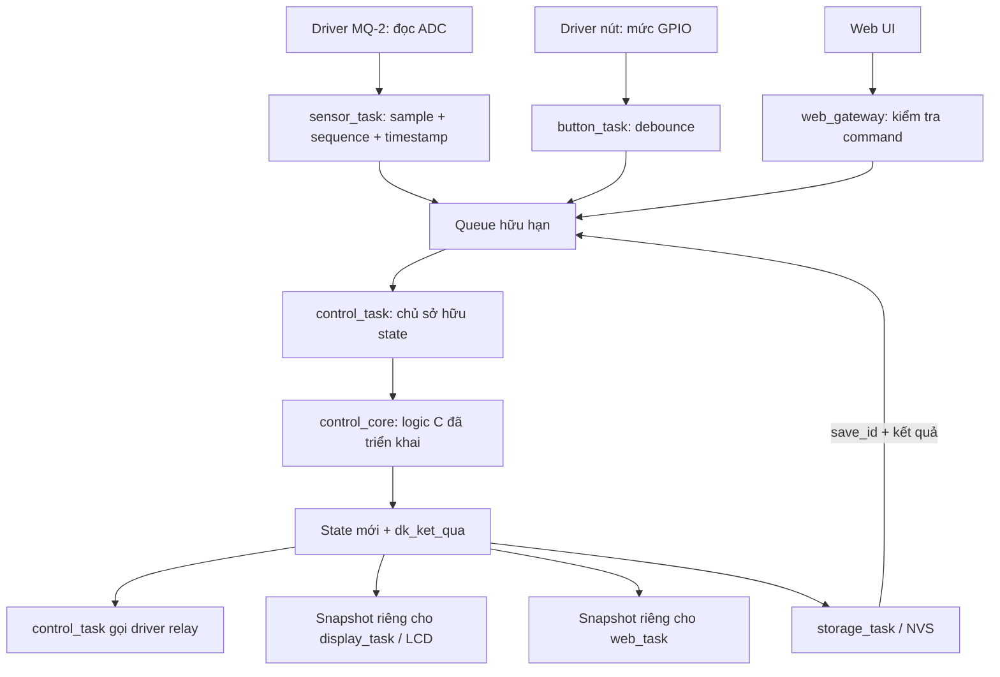

# Hướng dẫn đọc code và luồng toàn project

## Quy ước tiếng Việt

Tên do project định nghĩa dùng tiếng Việt không dấu; `dk_` là viết tắt của điều khiển. Chú thích dùng tiếng Việt có dấu. Giữ tên file/thư mục hiện tại để đường dẫn build và lệnh chạy không đổi. Từ khóa C, kiểu chuẩn (`uint64_t`, `bool`), hàm chuẩn (`memset`, `printf`), điểm vào `main`/`app_main` và API công cụ giữ nguyên.

| Tên cũ | Tên mới |
| --- | --- |
| cc_init | dk_khoi_tao |
| cc_dispatch | dk_xu_ly_su_kien |
| cc_next_deadline | dk_han_ke_tiep |
| cc_state | dk_trang_thai |
| cc_event | dk_su_kien |
| cc_result | dk_ket_qua |
| cc_config | dk_cau_hinh |

Ví dụ: `trang_thai->relay_bat` là đầu ra relay được yêu cầu; `trang_thai->phien_ban_nhap` là phiên bản ngưỡng đang chỉnh; `ket_qua->can_luu` yêu cầu tác vụ lưu thực hiện ghi cấu hình. Việc Việt hóa chỉ đổi cách đặt tên, không đổi luật điều khiển.

## 1. Phần nào đã chạy?

Cập nhật: đã bổ sung control_task, CMake và app_main demo không GPIO. Xem [control-task-guide.md](control-task-guide.md) để đọc phần mới; các mô tả "chưa có task/app_main trống" bên dưới ghi lại mốc triển khai core trước đó. Host test adapter đạt 243 checks, chưa có build/flash ESP-IDF thành công.

Đã viết `control_core` bằng C và host test GCC. Chưa có FreeRTOS task, driver, web hoặc NVS chạy thực tế. `main/Gas_System.c` vẫn trống; việc này có chủ đích: chưa đưa thời gian warm-up và ngưỡng giả của unit test lên phần cứng.

Thứ tự đọc:

1. `Gas_System/components/control_core/include/control_core.h`: kiểu dữ liệu và ba hàm public.
2. `Gas_System/components/control_core/control_core.c`: các quy tắc chuyển trạng thái.
3. `Gas_System/tests/control_core/test_control_core.c`: các ví dụ có đầu vào/kết quả kiểm chứng.

## 2. Luồng toàn hệ thống khi tích hợp



Ngoại trừ core, test và CMake component của core, các khối trên là thiết kế cần triển khai. Queue, giao thức JSON, debounce, lọc ADC và truy cập GPIO không nằm sẵn trong core.

## 3. Bốn cấu trúc quan trọng

**dk_cau_hinh** chứa luật có tham số: thời gian ổn định, hạn dữ liệu, số mẫu liên tiếp, khoảng chỉnh, hạn lưu, biên ngưỡng, hysteresis và seed bản nháp. Các giá trị trong test chỉ dùng để test nhanh và xác định. Hàm init kiểm tra quan hệ tham số; cấu hình không hợp lệ trả DK_KHONG_HOP_LE.

**dk_trang_thai** là trí nhớ của hệ thống. `che_do`, `tinh_trang_cam_bien`, `trang_thai_chinh` là ba chiều độc lập. Có thể vừa AUTO, READY và EDITING: hệ thống vẫn đánh giá ngưỡng đang có hiệu lực trong khi người dùng sửa bản nháp. `config_valid=false` biểu thị cần cấu hình; core hiện gộp missing/invalid thành cờ này, dịch vụ settings/UI sẽ lưu nguyên nhân cụ thể.

**dk_su_kien** là một việc vừa xảy ra: mẫu ADC mới, yêu cầu đổi mode, sửa ngưỡng, Save hoặc kết quả ghi flash. `ma_khoi_dong` ngăn sự kiện từ phiên boot khác. Kết quả Save chỉ được tạo từ storage nội bộ; gateway tương lai không được cho web gửi giả DK_LUU_THANH_CONG.

**dk_ket_qua** chứa kết quả lệnh, đầu ra relay và side effect cần thực hiện. Nó cũng là bản ghi cấu trúc để runtime ghi log. Core không gọi printf/ESP_LOG vì phải độc lập môi trường. Host harness hiện ghi result ra test.log; runtime tương lai cần chuyển sang ESP_LOG và ghi boot/session/revision để truy vết.

## 4. dk_khoi_tao: trạng thái ban đầu

Khởi tạo AUTO, WARMING, IDLE, relay OFF. Nếu ngưỡng được đọc từ storage có cờ valid và trong phạm vi thì sử dụng; nếu không, config_valid=false. Giá trị seed chỉ dùng tạo bản nháp khi chưa có ngưỡng, không âm thầm biến thành ngưỡng có hiệu lực.

Hàm không đọc flash. Tách như vậy cho phép test boot bằng cách truyền trực tiếp kết quả đọc cấu hình giả.

## 5. dk_xu_ly_su_kien: cửa vào duy nhất của logic

```text
Kiểm tra con trỏ/state
  → Từ chối thời gian đi lùi
  → Xử lý các deadline đã đến
  → Kiểm tra boot_id và xử lý sự kiện
  → Trả dk_ket_qua với trạng thái/output hiện tại
```

Điểm dễ bỏ sót: một lệnh bị từ chối vẫn có thể đi kèm `relay_changed=true`, vì cảm biến vừa hết hạn trước khi kiểm tra lệnh. Runtime phải thực hiện đầu ra từ result ngay cả khi status không phải DK_THANH_CONG. Không viết kiểu `if (status == OK) update_relay()`.

`dk_han_ke_tiep()` trả thời điểm cần gọi TICK tiếp theo để phát hiện sensor stale, edit timeout và Save timeout. Runtime chờ queue tối đa đến deadline đó. `UINT64_MAX` là không có hạn cần phục vụ; overflow phép cộng được bão hòa. Ready chỉ chuyển khi có mẫu mới đạt điều kiện, không tự chuyển bởi TICK dùng số đo cũ.

## 6. tiep_nhan_mau và danh_gia_tu_dong

Mỗi mẫu có sequence tăng và timestamp lấy mẫu, không dùng thời điểm xử lý queue thay thế. Mẫu lặp, timestamp lùi hoặc tương lai bị từ chối. Sequence bị đứt làm reset streak; đây là dấu hiệu task bị mất mẫu/queue overflow.

Mẫu hợp lệ phải đọc thành công, trong dải 0–4095 và còn mới. Kiểm tra này không phát hiện được mọi lỗi analog như dây đứt vẫn cho số ADC trong dải. Đầu vào core hiện là raw, chưa triển khai bộ lọc; pipeline lọc sẽ phải báo mẫu lỗi, không che lỗi bằng cách giữ mãi số đo cũ.

Khi đủ warm-up và streak thì READY. Auto bật tại `sample >= threshold`, tắt tại `sample <= threshold - hysteresis`, giữ trạng thái trong khoảng giữa. Khi vừa vào Auto/Ready, mặc định OFF trong khoảng giữa theo lựa chọn A của người dùng.

Ví dụ test: threshold=600, hysteresis=50. Chuỗi 600→575→550 cho relay ON→ON→OFF. Đây là số ADC giả, không phải ngưỡng khí an toàn.

Nếu không Ready hoặc không có cấu hình, Auto OFF. Manual không bị danh_gia_tu_dong thay đổi, nên vẫn điều khiển LED khi cảm biến lỗi. UI sau này phải hiển thị lỗi qua `tinh_trang_cam_bien`; không hiển thị sample cũ như dữ liệu hiện tại. Cảnh báo vượt ngưỡng dùng READY + config_valid + so sánh threshold, chưa có trường cảnh báo riêng trong core.

## 7. Bản nháp, revision và Save

`DK_BAT_DAU_CHINH` tạo edit_id mới; draft lấy từ threshold hiện hành hoặc seed nếu thiếu cấu hình. Trong lúc chỉnh, mode bị khóa (P1). Lệnh relay cũng bị khóa vì hai nút ON/OFF lúc đó mang ý nghĩa tăng/giảm.

`DK_DAT_BAN_NHAP` yêu cầu edit_id và expected_revision đúng. Thay đổi draft tăng revision; mẫu ADC mới không làm tăng draft_revision. Web nhìn revision 1 nhưng nút đã sửa thành 2 thì web nhận DK_DU_LIEU_CU, không ghi đè.

Core hiện nhận giá trị tuyệt đối; adapter nút tương lai sẽ tính +/- một bước từ state tại control_task rồi dùng cùng luật biên. Không để button_task tự đọc bản nháp từ bộ nhớ chung. Command ID dedup, state_revision tổng và JSON parsing chưa được triển khai.

`DK_YEU_CAU_LUU` khóa chỉnh (P2), phát `can_luu`, `ma_lan_luu`, `nguong_can_luu`. Runtime gửi bản sao giá trị này cho storage_task. Status DK_THANH_CONG ở đây chỉ nghĩa yêu cầu Save được chấp nhận, không nghĩa flash đã ghi.

- `DK_LUU_THANH_CONG` đúng save_id: đổi ngưỡng, đóng phiên, đánh giá lại Auto.
- `DK_LUU_THAT_BAI` đúng save_id: giữ ngưỡng cũ, giữ draft, quay EDITING và bắt đầu lại hạn chỉnh.
- Quá save_ms: vẫn SAVING, `save_uncertain=true`, chặn Save mới. Kết quả cũ không được gán vào giao dịch khác. Nếu storage không bao giờ trả kết quả, runtime cần read-back/reconciliation hoặc xử lý reset; cơ chế đó chưa có.

Mất web không phải lệnh hủy: core không cần event Wi-Fi. Runtime vẫn gọi TICK, nên nếu không có thao tác cả hai phía, phiên tự hết hạn. Reconnect chỉ xin snapshot, không làm mới deadline.

## 8. Chạy và đọc test

Từ thư mục workspace:

```powershell
powershell -NoProfile -ExecutionPolicy Bypass -File Gas_System/tests/control_core/run.ps1
```

Script dùng GCC, C11, `-Wall -Wextra -Werror -pedantic`; ghi build.log/test.log trong `Gas_System/tests/control_core/out/` (được ignore). Thư mục không cần board hoặc mạng.

Kết quả lượt triển khai: **DAT nhom=10 so_phep_kiem_tra=123**. Các nhóm test gồm hysteresis/warm-up, stale/recovery, mode và cấu hình thiếu, edit/save, revision/session/boot, edit deadline, save uncertain, mẫu cũ/sai, invalid input/time và overflow ID.

Tìm một tên hàm test rồi đọc các `KIEM_TRA` theo thứ tự: điều kiện đầu vào → gọi event → kiểm tra state/result. `ready(700)` tạo hai mẫu giả với timestamp xác định; không dùng sleep. Log số enum đối chiếu với header.

## 9. Bước triển khai kế tiếp

Tạo control_task và luồng queue/snapshot, kết nối output/log/save request của core; sau đó thêm driver và task I/O đã có folder. Driver cần các phép đo G0 trước thử điện thực tế. Khi thêm web phải thực hiện kiểm tra payload, command ID dedup, stale control command và reconnect; core pass không chứng minh các phần này đã hoạt động.

Host tests dùng harness C nhỏ thay vì Unity để tận dụng GCC đã có. Core có CMake component ESP-IDF, nhưng chưa chạy build ESP-IDF trong lượt này. Có thể bổ sung adapter Unity/on-target test sau; không thay test host bằng yêu cầu chờ board.
